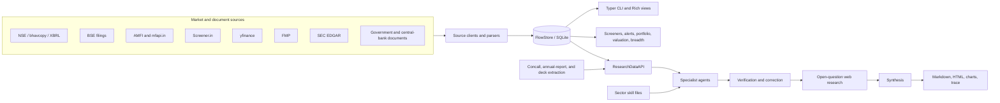

# Equity Research

A CLI-first research workspace for collecting market data, screening equities, and producing evidence-backed company research. The main application, **FlowTracker**, combines a local SQLite data store with deterministic analytics and a multi-agent Claude research pipeline. It is built primarily for Indian equities, with an expanding US-market path backed by SEC EDGAR and yfinance data.

> This is a research tool, not an execution platform or investment-advice service. It does not place trades. Source availability, model output, and point-in-time market data should all be independently checked before making financial decisions.

## Why this exists

This project started with a narrower question: where is institutional money actually moving in the Indian market? The useful evidence was scattered across daily FII/DII releases, mutual-fund disclosures, shareholding filings, bulk deals, company documents, and price data. Looking at any one of those feeds could tell a convincing but incomplete story.

FlowTracker grew into an attempt to do the research the way a careful individual investor would want to do it: collect the raw evidence once, keep its history, compare signals that normally live on different websites, and make every conclusion traceable back to data. The multi-agent layer came later, not to manufacture stock picks, but to make several analytical viewpoints work from the same evidence and challenge one another before a thesis is assembled.

The aim is a serious research desk that one person can run locally. It should help answer “what changed, why might it matter, and what evidence disagrees?” without pretending that an automated report is the final investment decision.

## What it does

- Tracks FII/DII flows, mutual-fund activity, shareholding, promoter pledges, insider transactions, bulk/block deals, delivery data, F&O positioning, breadth, valuations, filings, and macro indicators.
- Normalizes source data into a local SQLite database so analytics and research agents read the same persisted evidence.
- Screens stocks with a composite factor model and exposes direct JSON queries for the research data layer.
- Tracks portfolios, alerts, catalysts, and file-based thesis conditions.
- Produces Markdown and HTML company theses from specialist agents covering business, financials, ownership, valuation, risk, technicals, sector, news, macro, historical analogs, and F&O positioning.
- Verifies specialist output, resolves open questions through a constrained web-research stage, synthesizes the evidence, and records per-run traces and costs.
- Supports sector-specific prompt overlays and Gemini-graded auto-evaluation for iterative prompt improvement.

## Architecture



The system deliberately separates fetching from analysis. Source clients parse and normalize external data; `FlowStore` persists it; deterministic engines and `ResearchDataAPI` read the database; research agents receive curated tools instead of direct database or shell access. Live refresh happens before a research run, while individual source failures degrade independently where possible.

### Research pipeline

1. Resolve the market and refresh company, peer, and macro data.
2. Download and extract concalls, annual reports, investor decks, and macro anchor documents.
3. Run the specialist set with bounded concurrency and tier-aware retries.
4. Verify eligible briefings and apply corrections.
5. Research unresolved questions, then synthesize a cross-agent verdict.
6. Assemble technical Markdown/HTML, optionally add beginner-friendly annotations, and save an execution trace.

The default pipeline supports both India and US symbols. India coverage draws heavily on NSE, BSE, Screener.in, AMFI, and Indian macro sources. The US path uses SEC/yfinance data and auto-detects registered NASDAQ/NYSE symbols; some India-specific tools intentionally return no data for US runs.

## Repository layout

```text
.
├── flow-tracker/          # Installable Python package and the flowtrack CLI
│   ├── flowtracker/       # Clients, models, commands, store, engines, research system
│   ├── tests/             # Unit, integration, e2e, contract, and quality tests
│   ├── scripts/           # Backfills, migrations, scheduled jobs, eval workers
│   ├── docs/              # Source/API notes
│   ├── tools/             # Standalone utilities
│   └── pyproject.toml
├── autoagent-pilot/       # Prompt hill-climbing benchmark and experiment ledger
├── scripts/               # Workspace-level autoeval orchestration
└── plans/                 # Design and implementation plans
```

Important implementation seams:

- `flow-tracker/flowtracker/main.py` registers the CLI and command groups.
- `flow-tracker/flowtracker/store.py` owns the SQLite connection, schema, migrations, and composed domain mixins under `flow-tracker/flowtracker/store_domains/`.
- `flow-tracker/flowtracker/research/data_api.py` is the unified read layer exposed to research tools.
- `flow-tracker/flowtracker/research/agent.py` orchestrates specialist, verification, web-research, synthesis, and explainer stages.
- `flow-tracker/flowtracker/research/prompts.py` composes shared, specialist, and sector-specific instructions.
- `flow-tracker/flowtracker/research/assembly.py` generates the final Markdown and HTML reports.

Most data-source features follow a consistent `*_models.py` → `*_client.py` → `*_commands.py` → `*_display.py` structure.

## Requirements

- Python 3.12 or newer
- [`uv`](https://docs.astral.sh/uv/)
- A working Claude Agent SDK/Claude Code authentication setup for AI research and document extraction
- Network access to the selected upstream sources
- Chromium for JavaScript-rendered source fallbacks; the real Chrome channel is also used by stealth-enabled BSE fallbacks
- macOS only if you want the supplied LaunchAgent scheduling scripts

Screener.in credentials are required for authenticated financial exports. FMP is optional and most of its endpoints require a paid plan.

## Setup

```bash
git clone https://github.com/tarangdeep-goel-by/equity-research.git
cd equity-research/flow-tracker

uv sync
uv run playwright install chromium
uv run playwright install chrome
uv run flowtrack --help
```

The default database is `~/.local/share/flowtracker/flows.db`. Override it for an isolated run or test database:

```bash
export FLOWTRACKER_DB=/path/to/flows.db
```

Configure optional authenticated sources outside the repository:

```bash
mkdir -p ~/.config/flowtracker

printf '%s\n' \
  'SCREENER_EMAIL=you@example.com' \
  'SCREENER_PASSWORD=your-password' \
  > ~/.config/flowtracker/screener.env

printf '%s\n' \
  'FMP_API_KEY=your-api-key' \
  > ~/.config/flowtracker/fmp.env
```

Do not commit either credential file.

## Usage

Run commands from `flow-tracker/`.

### Build the local data set

```bash
# Daily institutional flows
uv run flowtrack fetch
uv run flowtrack summary
uv run flowtrack flows --period 30d

# Company fundamentals and ownership
uv run flowtrack fund fetch --symbol RELIANCE
uv run flowtrack holding fetch --symbol RELIANCE --quarters 8

# Market context
uv run flowtrack macro fetch
uv run flowtrack breadth latest
```

Use `uv run flowtrack --help` and `uv run flowtrack <group> --help` for the complete command surface.

### Screen and monitor

```bash
uv run flowtrack screen top --limit 20
uv run flowtrack screen score RELIANCE

uv run flowtrack portfolio add SBIN --qty 50 --cost 920
uv run flowtrack portfolio view

uv run flowtrack alert add SBIN price_below 750 --notes "support level"
uv run flowtrack alert check
```

### Query the deterministic research layer

```bash
uv run flowtrack research data fair_value --symbol SBIN
uv run flowtrack research data dupont_decomposition --symbol SBIN
uv run flowtrack research data shareholding_changes --symbol INDIAMART
uv run flowtrack research data macro_snapshot
```

Add `--raw` when another program should consume compact JSON.

### Generate research

```bash
# Full refresh, document pipeline, specialists, verification, synthesis, and report
uv run flowtrack research thesis --symbol INDIAMART

# Explicit US-market run
uv run flowtrack research thesis --symbol MSFT --market us

# Re-run selected specialists
uv run flowtrack research run business,risk --symbol INDIAMART

# Data-only HTML report, without the multi-agent thesis pipeline
uv run flowtrack research fundamentals --symbol INDIAMART
```

Research artifacts are written under `~/vault/stocks/<SYMBOL>/`; convenience report copies are also written beneath `flow-tracker/reports/`. Full thesis runs use paid model/API capacity and may take several minutes.

### Scheduled refreshes

The scripts in `flow-tracker/scripts/` cover daily, weekly, monthly, and quarterly ingestion. On macOS, install the supplied LaunchAgents with:

```bash
cd flow-tracker
bash scripts/setup-crons.sh
```

Review the script and plist templates before installing: they write to the user-level FlowTracker data and log directories and call external market-data services.

## Data conventions

- Monetary aggregates are stored in crores (`₹1 Cr = ₹10 million`).
- Per-share values are stored in rupees; counts such as shares and volume remain raw.
- Margins, returns, growth, and yields use percentage form (`25.0` means 25%); valuation multiples remain ratios.
- Multi-period price analytics use adjusted close where available; raw bhavcopy OHLC remains unadjusted.
- Research tools read persisted data. Fetch/refresh orchestration owns live network access.
- Upserts and source-specific uniqueness constraints make repeat ingestion idempotent where supported.

## Testing

```bash
cd flow-tracker

# Install test dependencies
uv sync --extra test

# Fast suite used for local iteration and CI coverage
uv run pytest -m "not slow"

# Slow CLI smoke tests
uv run pytest -m "slow"

# Full suite
uv run pytest

# Coverage gate used by CI
uv run pytest -m "not slow" \
  --cov=flowtracker --cov-branch --cov-report=term --cov-fail-under=74
```

Tests are grouped under `flow-tracker/tests/unit/`, `flow-tracker/tests/integration/`, `flow-tracker/tests/e2e/`, `flow-tracker/tests/contract/`, and `flow-tracker/tests/quality/`. Network parsers use recorded fixtures or mocks where practical; live-source freshness is a separate operational concern.

## Auto-evaluation

Install the extra grader dependency before running evals:

```bash
cd flow-tracker
uv sync --extra test --extra autoeval

# One specialist/sector
uv run flowtrack research autoeval --agent business --sectors bfsi

# Resumable multi-sector worker pool
scripts/eval_parallel.sh 3 textiles,building_materials,packaging
```

`autoagent-pilot/` adds a bounded prompt-experiment loop and benchmark ledger. Autoeval histories, run logs, last-run metadata, and generated result tables are runtime state and must not be committed.

## Limitations and security

- This is a single-user local application, not a hardened multi-tenant service.
- Data freshness and coverage vary by source; upstream HTML/API changes can break parsers.
- FMP coverage depends on plan level, and some US ownership data is manager-indexed rather than complete issuer-level coverage.
- LLM reports can omit context or reason incorrectly even when their cited inputs are correct. The verifier reduces risk but does not eliminate it.
- Agent and extractor processes use narrowly selected research tools, but some SDK runs use bypassed permission prompts. Run the project only in an environment and account you trust.
- Generated research, downloaded filings, traces, and the SQLite database may contain sensitive personal research. Keep the vault and config directories private.

Further source-specific notes live in [`flow-tracker/docs/`](flow-tracker/docs/), while [`flow-tracker/ROADMAP.md`](flow-tracker/ROADMAP.md) records planned work.
